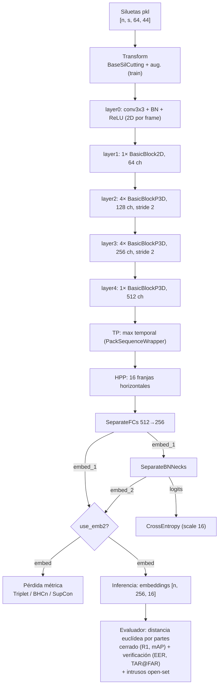
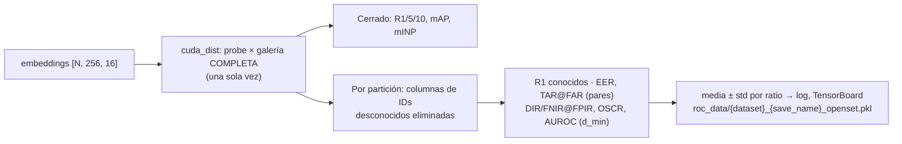

# Arquitectura — OpenSet-Gait

Base: fork de [OpenGait](https://github.com/ShiqiYu/OpenGait) (upstream `f754f6f`). Modelo de referencia: **DeepGaitV2 (modo `p3d`)** sobre siluetas, configuración `configs/deepgaitv2/DeepGaitV2_gait3d.yaml`. Evaluación open-set encima de los embeddings (ver `opengait/evaluation/evaluator.py`).

## 1. Diagrama



## 2. Dimensiones (Gait3D, entrenamiento)

Batch del `TripletSampler`: 32 identidades × 4 secuencias → `n = 128`; `s = 30` frames.

| Etapa | Shape | Notas |
|---|---|---|
| Entrada | `[n, 1, s, 64, 44]` | `assert` anchura ∈ {44, 88} |
| layer0 / layer1 | `[n, 64, s, 64, 44]` | |
| layer2 | `[n, 128, s, 32, 22]` | stride espacial 2 |
| layer3 | `[n, 256, s, 16, 11]` | stride espacial 2 |
| layer4 | `[n, 512, s, 16, 11]` | |
| TP (max sobre `s`) | `[n, 512, 16, 11]` | respeta `seqL` |
| HPP (16 bins) | `[n, 512, 16]` | `p = 16` partes |
| `embed_1` (SeparateFCs) | `[n, 256, 16]` | |
| `embed_2`, `logits` (BNNecks) | `[n, 256, 16]`, `[n, 3000, 16]` | 3000 IDs de entrenamiento |

`embed = embed_2 if use_emb2 else embed_1` se usa tanto en la pérdida métrica como en la inferencia. Upstream entrenaba la triplet siempre con `embed_1`; en este fork solo cambia con `use_emb2: true` (hoy únicamente `DeepGaitV2_Gait3D_SupCons_Euc.yaml`).

## 3. Funciones de pérdida

Todas operan por parte (`[p, n, c]`) y se suman a la CE del BNNeck (peso 1.0).

| Tipo (`loss_cfg.type`) | Fichero | Definición |
|---|---|---|
| `TripletLoss` | `losses/triplet.py` | `relu(d_ap − d_an + m)`, `m = 0.2`, media de no-ceros. Registra media/std de `d_ap` y `d_an`. |
| `BHCLoss` | `losses/bhc.py` | Batch-hard: `relu(max d_ap − m1) + relu(m2 − min d_an)`; `m1 = 0.2`, `m2 = 0.5` y se duplica cada 20k iteraciones. |
| `BHCLossV2` | `losses/bhcV2.py` | `relu(d_p) + relu(m − d_n)` con margen fijo `m` (config: 10). |
| `BHCLossV3` | `losses/bhcV3.py` | Grouped BHCn (ec. 6 de Aljazaerly et al. 2023): pérdidas promediadas entre partes, después hardest positivo/negativo y al cuadrado; `m = 8`, +2 cada 15k iteraciones. |
| `SupConLoss_Lp` | `losses/supconloss.py` | SupCon con distancia euclídea sobre embeddings normalizados L2, `T = 0.07`. |
| `SupConLoss_Euc` | `losses/supconloss.py` | SupCon con distancia euclídea **sin normalizar**, `T = 1`. Distancia calculada a mano (evita el NaN del gradiente de `torch.cdist` en 0). |
| `CrossEntropyLoss` | `losses/ce.py` | Sobre `logits` del BNNeck, `scale = 16`. |

## 4. Evaluación open-set (`opengait/evaluation/openset.py`)



- **Particiones**: para cada `unknown_ratio` (por defecto 10/30/50 %), `n_splits` (10) conjuntos aleatorios de IDs desconocidos, con semilla fija, tomados de las identidades del probe. Sus secuencias salen de la galería; todos los probes se conservan. Un probe es *conocido* si y solo si su ID sigue en la galería reducida. Además se calcula `legacy10` (último 10 % de IDs ordenados), la partición del código anterior, para comparar con resultados previos.
- **Regla de decisión**: el probe se acepta si `d_min < τ`, siendo `d_min` la distancia al vecino más cercano de la galería; si se acepta, se identifica con ese vecino. DIR@FPIR=x fija τ para que, como mucho, una fracción x de los probes desconocidos se acepte.
- **Protocolo `su2024`** (Su et al., ECCV 2024; también LocalScore, arXiv 2602.01012), para comparar con la literatura. Se calcula junto al anterior (`su2024: true` por defecto):
  - el 21.5 % de las IDs son desconocidas, con 50 particiones. En Gait3D son **las publicadas por Su et al.** (`datasets/Gait3D/su2024_nonmated_ids.json`, convertidas de su `openset_nonmated.npy`; `su2024_splits: official`); en otros datasets, aleatorias (seed 0);
  - la galería se reduce a una **plantilla media por identidad** (`subject_templates`), y la distancia probe × plantilla se calcula una sola vez;
  - FNIR@1 % y 5 % FPIR, con rank R = 1 y R = 20 (claves `*_r20`; Su et al. usan R = 20: el probe acierta si su puntuación genuina supera el umbral y su identidad está entre las R primeras);
  - umbral como en el código de Su (`threshold_rule: su2024`): con k = ⌊FPIR·n⌋ intrusos permitidos, se acepta d ≤ k-ésima `d_min` desconocida más baja. El protocolo unificado sigue con `strict` (d < (k+1)-ésima);
  - el `rank1` de su2024 es contra las plantillas; el R1 que publican Su et al. es el cerrado (galería completa);
  - verificado contra `compute_dir_far` del repositorio de Su (diferencia 0 en las 50 particiones);
  - se resume con la mediana (`results['su2024']['median']`) ± std, como Su et al., y con la media ± IC 95 % (`ci95` = 1.96·std/√50), como LocalScore.
  - **Variantes de puntuación** (`su2024_similarity` × `su2024_localscore_k`, por defecto las cuatro; clave `su2024[_cos][_ls{k}]`):
    - `euc`: plantilla = media de los embeddings, `s = 1/(1+d)` con la distancia euclídea por partes (ec. 6 de Su et al.; mismas métricas que ordenar por `d`).
    - `cos`: plantilla = media de los embeddings normalizados L2 por parte, similitud coseno por partes (ec. 1 de LocalScore).
    - LocalScore *k* (arXiv 2602.01012, ec. 4): `t = s + 1[sujeto top]·s⁽ᵏ⁾`, con `s⁽ᵏ⁾` la k-ésima mayor similitud del probe con las **secuencias** de la galería, sin usar etiquetas. Se recalcula por partición, sin las secuencias de los sujetos desconocidos (`localscore_dist`). No cambia el Rank-1, solo la puntuación de detección.
- **Configuración** (opcional, en `evaluator_cfg`):
  ```yaml
  openset_cfg:
    unknown_ratios: [0.1, 0.3, 0.5]
    n_splits: 10
    seed: 0
    fpir: [0.01, 0.1]
    far: [0.01, 0.001]
    legacy_split: true
    output_dir: roc_data
  ```
    su2024: true
    su2024_similarity: [euc, cos]
    su2024_localscore_k: [0, 1]
    su2024_splits: official   # o ruta a un json {"nonmated_ids": [[...], ...]}, o null (aleatorias)
    dir_ranks: [1]            # su2024: [1, 20]
    threshold_rule: strict    # su2024: su2024
- **Salida pkl**: `results[split]` contiene `unknown_ids`, `metrics` y `curves` por partición (curva DIR–FPIR, `d_min`, `is_known`, `correct`, ROC de verificación submuestreada) y `summary` (media, std). También guarda `probe_features`, `gallery_features`, `probe_lbls` y `gallery_lbls` (galería completa), con las mismas claves que los pkl antiguos.
- Integrado en `evaluate_Gait3D` y `evaluate_GREW` a través de `closed_and_openset` (cerrado + open-set sobre la misma matriz de distancias). SUSTech1K, CCPG y CCGR se conectan al preparar los datos (CU-123nktjx7ym): basta con pasar `dist`, `probe_lbls` y `gallery_lbls` a `run_protocol`.
- **GREW local** (`configs/deepgaitv2/DeepGaitV2_grew_openset.yaml`, `eval_func: evaluate_GREW`): el probe oficial solo se puntúa en el servidor remoto, así que se evalúa con la galería oficial, que tiene una secuencia `01` y otra `02` por cada una de las 6000 IDs de test. `01` hace de galería y `02` de probe; un único match por probe. La partición `datasets/GREW/GREW_local_test.json` quita el probe oficial (`probe`) del `TEST_SET` para no extraer sus embeddings. `legacy10` desactivado por defecto.
- Tests: `python tests/test_openset.py` (embeddings perfectos, aleatorios, DIR@FPIR —también con rank R y regla de umbral de Su— y LocalScore calculados a mano, particiones fijas, ausencia de fugas, reproducibilidad de particiones).
