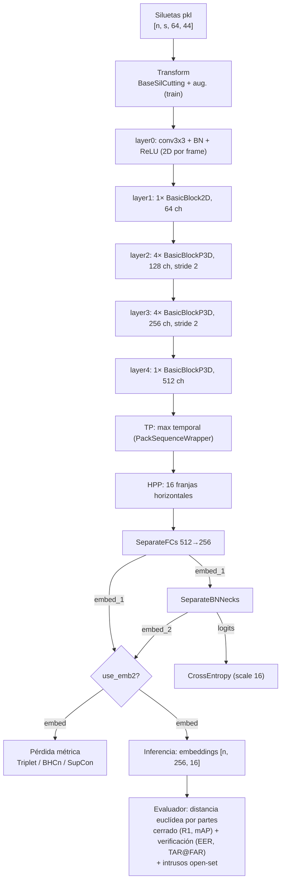

# Arquitectura — OpenSet-Gait

Base: fork de [OpenGait](https://github.com/ShiqiYu/OpenGait) (upstream `f754f6f`). Modelo de referencia: **DeepGaitV2 (modo `p3d`)** sobre siluetas, configuración `configs/deepgaitv2/DeepGaitV2_gait3d.yaml`. Evaluación open-set encima de los embeddings (ver `opengait/evaluation/evaluator.py`).

## 1. Diagrama

## 2. Dimensiones (Gait3D, entrenamiento)

Batch del `TripletSampler`: 32 identidades × 4 secuencias → `n = 128`; `s = 30` frames.

| Etapa | Shape | Notas |
|---|---|---|
| Entrada | `[n, 1, s, 64, 44]` | `assert` anchura ∈ {44, 88} |
| layer0 / layer1 | `[n, 64, s, 64, 44]` | |
| layer2 | `[n, 128, s, 32, 22]` | stride espacial 2 |
| layer3 | `[n, 256, s, 16, 11]` | stride espacial 2 |
| layer4 | `[n, 512, s, 16, 11]` | |
| TP (max sobre `s`) | `[n, 512, 16, 11]` | respeta `seqL` |
| HPP (16 bins) | `[n, 512, 16]` | `p = 16` partes |
| `embed_1` (SeparateFCs) | `[n, 256, 16]` | |
| `embed_2`, `logits` (BNNecks) | `[n, 256, 16]`, `[n, 3000, 16]` | 3000 IDs de entrenamiento |

`embed = embed_2 if use_emb2 else embed_1` se usa tanto en la pérdida métrica como en la inferencia. Upstream entrenaba la triplet siempre con `embed_1`; en este fork solo cambia con `use_emb2: true` (hoy únicamente `DeepGaitV2_Gait3D_SupCons_Euc.yaml`).

## 3. Funciones de pérdida

Todas operan por parte (`[p, n, c]`) y se suman a la CE del BNNeck (peso 1.0).

| Tipo (`loss_cfg.type`) | Fichero | Definición |
|---|---|---|
| `TripletLoss` | `losses/triplet.py` | `relu(d_ap − d_an + m)`, `m = 0.2`, media de no-ceros. Registra media/std de `d_ap` y `d_an`. |
| `BHCLoss` | `losses/bhc.py` | Batch-hard: `relu(max d_ap − m1) + relu(m2 − min d_an)`; `m1 = 0.2`, `m2 = 0.5` y se duplica cada 20k iteraciones. |
| `BHCLossV2` | `losses/bhcV2.py` | `relu(d_p) + relu(m − d_n)` con margen fijo `m` (config: 10). |
| `BHCLossV3` | `losses/bhcV3.py` | Grouped BHCn (ec. 6 de Aljazaerly et al. 2023): pérdidas promediadas entre partes, después hardest positivo/negativo y al cuadrado; `m = 8`, +2 cada 15k iteraciones. |
| `SupConLoss_Lp` | `losses/supconloss.py` | SupCon con distancia euclídea sobre embeddings normalizados L2, `T = 0.07`. |
| `SupConLoss_Euc` | `losses/supconloss.py` | SupCon con distancia euclídea **sin normalizar**, `T = 1`. Distancia calculada a mano (evita el NaN del gradiente de `torch.cdist` en 0). |
| `CrossEntropyLoss` | `losses/ce.py` | Sobre `logits` del BNNeck, `scale = 16`. |

## 4. Evaluación open-set (estado actual)

- `evaluate_Gait3D`: Rank-1/5/10, mAP y mINP con la galería completa. Después, el último 10 % de IDs ordenados se quita de la galería como intrusos → EER, TAR@1%FAR y TAR@0.1%FAR sobre todos los pares probe×galería.
- Pendiente (CU-123nktjx7yk): partición aleatoria repetida, DIR@FPIR, OSCR y AUROC, y salida con nombre por modelo.
